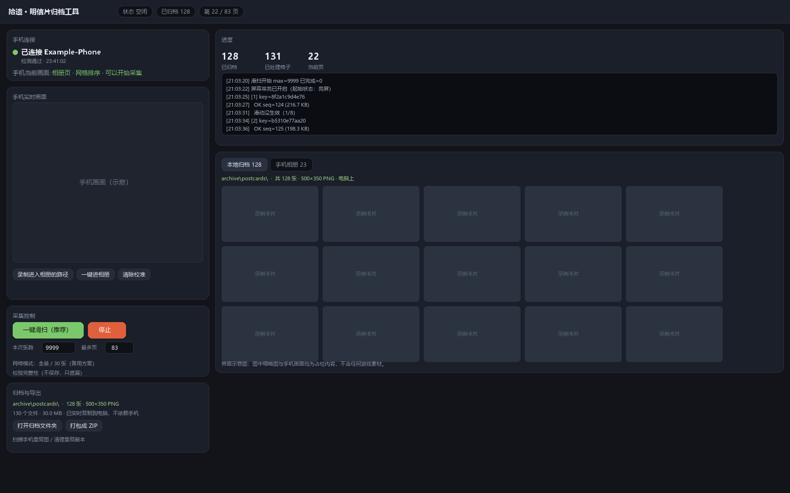

# Keepsake · Postcard Archiver for *Travel Frog: China Adventure*

[简体中文](README.md) · **English**

**This tool is purpose-built for the postcard album in *Travel Frog: China Adventure*.**
Saving a postcard in the game is a per-image chore: open one, tap save, close, open the next.
With hundreds of postcards that is tedious and easy to get wrong. This tool drives your phone
over ADB from your own computer, performs "open → save → next" automatically, and copies each
newly created original file to your PC in real time while writing a readable manifest.



> The image above is the tool's interface. Thumbnails and the phone preview are placeholders
> and contain no game assets.

**Scope**: the postcard album of *Travel Frog: China Adventure* (Android).
The collection logic itself is not tied to this title — any album-style app that offers
"detail page + save button + horizontal swipe" can work after re-calibration, but the
**default parameters are calibrated for this game**.

> **This repository contains no game assets and does not modify the game client.**
> The tool does exactly three things: capture the screen, inject taps, watch for and copy
> newly created image files. No decryption, no reading of app-private data, no bundled art.

---

## Table of contents

- [The problem it solves](#the-problem-it-solves)
- [What it does and does not do](#what-it-does-and-does-not-do)
- [How it works](#how-it-works)
- [Requirements](#requirements)
- [Quick start](#quick-start)
- [First run: calibration](#first-run-calibration)
- [Collection workflow](#collection-workflow)
- [Archive format](#archive-format)
- [Local browsing and export](#local-browsing-and-export)
- [Adapting to another device](#adapting-to-another-device)
- [Troubleshooting](#troubleshooting)
- [Privacy](#privacy)
- [Legal and scope](#legal-and-scope)
- [Repository layout](#repository-layout)
- [Development](#development)
- [AI-generated disclosure](#ai-generated-disclosure)

---

## The problem it solves

Saving one postcard in the game takes: open one, tap save, close it, open the next one.
Doing that for hundreds of images is boring, error-prone, and — worse — **you cannot tell
which ones you missed**.

This tool hands the loop to a script, and treats **"a new file actually appeared on disk"**
as the only definition of success. It never assumes "I tapped it, so it probably worked".
Every image is recorded with its file hash, and a separate verification pass can walk the
album again and tell you whether anything was missed.

The exported images are the originals the game itself writes (500×350 PNG, no frame, no
watermark). They are **not** screenshots, so there is no recompression loss.

---

## What it does and does not do

| Does | Does not |
|---|---|
| Capture the screen and locate buttons by template matching | ❌ No decryption, no key extraction |
| Inject taps (160–320 ms long-press) | ❌ No reading app-private dirs / memory / databases |
| Watch the album directory for new files | ❌ No patching, hooking, or repackaging |
| Copy new files to the PC and write a manifest | ❌ No network access; fully offline |
| Deduplicate by file hash and by frame hash | ❌ No bundled or redistributed game assets |
| Local web UI for browsing and ZIP export | ❌ No access to account data |

The only external dependency is the app's own "save to album" feature — the tool merely
presses it for you.

---

## How it works

```
┌─────────┐   ① screencap (adb exec-out screencap)   ┌──────────────┐
│  Phone  │ ◀────────────────────────────────────── │              │
│  app UI │                                         │  Collector   │
│         │ ──────────────────────────────────────▶ │  (Python)    │
└─────────┘   ② tap (adb shell input swipe)          └──────┬───────┘
     │                                                      │
     │ ③ the app writes /sdcard/Pictures/<epoch>.png        │
     ▼                                                      │
┌─────────────┐   ④ poll the directory, detect new files ──┘
│ Album folder│   ⑤ adb pull to the PC + write manifest.json
└─────────────┘
```

Design decisions, all derived from real-device testing:

1. **Taps must be long-presses.** `adb shell input tap` is too short; some engines
   (Egret/Canvas-based ones in particular) discard it as an invalid gesture.
   The tool uses `input swipe x y x y 160` instead — equivalent to a 160 ms press.
2. **The app locks input for 2–3 seconds after saving.** Tapping "close" during that window
   does nothing, so the tool waits first.
3. **Success is measured by files, not by clicks.** A snapshot of the album directory is taken
   before each save; afterwards the tool polls for a new file (up to 10 s). No file, no success.
4. **Paging is done by swiping, not by grid coordinates.** The detail view supports horizontal
   swipes between adjacent cards, so collection becomes "save → swipe left". This removes any
   dependency on grid layout, pagination, or sort order.
5. **"Swipe did not register" is distinguished from "end of album".** Each frame is hashed over
   the postcard area *and* the page-number area. An unchanged hash means the swipe failed
   (retry); only repeated failures after ~480 positions conclude the album is exhausted.

---

## Requirements

| Item | Requirement |
|---|---|
| OS | Windows 10 / 11 (primary, tested). macOS / Linux should work but are untested |
| Python | 3.10+ |
| Packages | `numpy`, `Pillow` (see `requirements.txt`) |
| ADB | Google platform-tools `adb` |
| Phone | Android device with the app installed and signed in; USB debugging enabled |
| Screen | Calibrated for **1316 × 2832**; other resolutions need re-calibration |

> Verified on HarmonyOS 4.3.0 (Android 12 / API 31), arm64.

---

## Quick start

```bash
git clone https://github.com/TinyYang/keepsake.git
cd keepsake
pip install -r requirements.txt
```

**Provide adb** (any one of):

```text
1. Extract platform-tools into  tools/platform-tools/   (recommended; ignored by git)
2. Set the environment variable  ADB_PATH=D:\platform-tools\adb.exe
3. Put adb on your system PATH
```

**Connect the phone**:

```bash
adb devices -l
```

You must see `xxxxxxxx  device`. If it says `unauthorized`, accept the "Allow USB debugging"
prompt on the phone. If the list is empty, check the cable (many are charge-only), set the USB
mode to "File transfer", and close any vendor assistant software that may hold the ADB port.

**Start the tool** (Windows):

```text
start.cmd
```

This starts a local server bound to `127.0.0.1` and opens your browser
(default <http://127.0.0.1:8787/>; the port moves up automatically if it is taken).

macOS / Linux:

```bash
python scripts/server.py
```

---

## First run: calibration

The built-in constants are tied to a specific screen resolution. On a different device you
must re-calibrate. Do this once:

### 1. Check the resolution

```bash
adb shell wm size
```

If it is not `1316x2832`, read [docs/CALIBRATION.md](docs/CALIBRATION.md) first.

### 2. Record the path into the album

The tool needs to know how to get from the app's home screen to the album:

1. Leave the phone on the app's **home screen**
2. Click **"录制进入相册的路径"** (record navigation path)
3. **In the phone preview on the page**, tap where you would normally tap, in order
   (each click is executed on the phone)
4. When the album is open, click **"结束录制并保存"** (finish and save)

The path is stored in `probe/nav.json` and reused automatically. Without a recording, the tool
falls back to a built-in default computed from proportions, which may be inaccurate.

### 3. Open one postcard

Collection starts from the detail view. The "one-click sweep" button handles this for you; if
you operate manually, open any postcard and leave it on screen.

---

## Collection workflow

Four steps, each interruptible and resumable:

### 1. One-click sweep

Click **"一键滑扫"** (one-click sweep). It will:

```text
enable stay-awake → check lock screen → cold-start the app → follow the navigation path
→ open the first postcard → [save → swipe left] loop → stop automatically at the end
```

- About 9–10 seconds per card (including post-save waits)
- Cards already archived are skipped, so no duplicate files pile up
- Progress is stored in `probe/sweep_state.json`; restarting fast-forwards to the last position

### 2. Scan duplicates on the phone

Click **"扫描手机重复图"** (scan duplicates). It reports how many timestamp-named PNGs exist,
how many are unique, how many are duplicate copies, and which files are not postcards at all
(filtered by the 500×350 size check).

### 3. Review and clean

**"清理重复副本"** opens a review panel: each group shows thumbnails side by side, with the
kept copy on the left and removable duplicates on the right. Every duplicate can be unchecked;
deletion happens only after you confirm.

Safety constraints:

- Only byte-identical copies (`md5`) are removed, and each group always keeps at least one
- Only 500×350 images are touched; everything else is left alone
- The delete endpoint validates against a whitelist and refuses unknown files

### 4. Verify completeness

**"校验完整性"** (verify) walks the album again **without saving anything**, comparing each
card against the archived set, and reports how many were never archived. Zero means no misses.

> Verification relies on the frame hashes recorded during the sweep, so run it after a full sweep.

---

## Archive format

```
archive/
├── manifest.json        metadata for every image (plain JSON, not encrypted)
├── postcards/           original images
│   ├── 0001_1792320907585.png
│   └── ...
└── README.txt           a note for the future: what these files are, how they were produced
```

`manifest.json` fields:

| Field | Meaning |
|---|---|
| `seq` | Archive index, matching the filename prefix |
| `file` | Relative path |
| `original_name` | Original filename written by the app (usually an epoch timestamp) |
| `source` | How it was obtained |
| `device` / `package` | Capturing device and target app identifier |
| `order` | Position in the album traversal (sweep mode) |
| `captured_at` | Capture time |
| `bytes` / `sha256` | File size and hash (dedupe + integrity) |
| `width` / `height` | Image dimensions |
| `location` / `note` / `favorite` / `hidden` | Reserved: place, note, favorite, hidden |

Originals are **treated as read-only**: tidying, deduplicating and renaming only ever produce
copies; source files are never overwritten.

---

## Local browsing and export

The page has two tabs, "local archive" and "phone album":

- Thumbnail wall, click for full screen, `←` `→` to page, scroll wheel to zoom
- "打包成 ZIP" packs `archive/` into a downloadable archive
- "打开归档文件夹" opens the local folder in Explorer

Browsing is fully static and needs no network.

---

## Adapting to another device

Three things force a re-calibration: **resolution**, **app version UI**, and **how the OS treats
injected input**. See [docs/CALIBRATION.md](docs/CALIBRATION.md). The constants to change:

| Constant | File | Meaning |
|---|---|---|
| `SLOTS` | `scripts/frogcap.py` | Centers of the six grid cards |
| `CAMERA_BOX` / `CAMERA_PT` | `frogcap.py`, `swipecap.py` | Camera icon match box and tap point |
| `CLOSE_PT` | same | Close button in the detail view |
| `SWIPE_FROM` / `SWIPE_TO` | `swipecap.py` | Left-swipe start and end points |
| `POSTCARD_CROP` | same | Postcard area, used for hashing |
| `PAGE_CROP` | same | Page-number area, used to detect stalls |

The template image (`templates/camera_icon.png`) is cropped at runtime from your own screenshots
and is **not** shipped with the repository.

---

## Troubleshooting

| Symptom | Cause | Fix |
|---|---|---|
| Page says "no phone detected" | adb cannot start / charge-only cable / not authorized | Verify `adb devices` by hand; click "诊断" on the page for raw output |
| Page will not open, port busy | Stale process | The tool moves to the next free port; use the URL printed in the console |
| Repeated "swipe did not register" | App busy or animation not finished | The engine retries 8 times, then stops safely and keeps progress |
| Collection stops midway | Screen lock / incoming call / cable | Unlock and click the sweep button again; it resumes from the checkpoint |
| Cannot close the dialog after saving | The app locks input for 2–3 s | A 2.6–4 s wait is built in; do not intervene manually |
| Duplicates keep appearing | Older builds re-saved archived cards | Run "scan → review → clean" once |
| Exported images are only 500×350 | That is the app's own export resolution | Screenshots only yield an upscaled copy, never more detail |

---

## Privacy

- **All data stays on your machine**: images, manifests and logs live under `archive/` and `probe/`.
- **No network access**: apart from the local `127.0.0.1` server, the tool makes no requests.
- **No personal data in the repository**: `.gitignore` excludes `archive/`, `probe/`,
  `templates/` and `export/`. `probe/` holds runtime screenshots (which may show your desktop,
  notifications or wallpaper) — never commit it.
- When filing an issue, remove personal details from screenshots first (device serial numbers,
  notification contents, wallpaper photos).

---

## Legal and scope

- For personal backup of content visible on your own device only.
- The repository contains **no** game art, audio, text or client files; template images are
  generated at runtime from the user's own screenshots.
- Do not redistribute exported material publicly or use it commercially. Copyright in the
  underlying works belongs to their respective owners.
- Using this tool may conflict with the target app's terms of service. Evaluate and accept that
  risk yourself.
- This project is not affiliated with, endorsed by, or authorized by any game publisher.

---

## Repository layout

```
keepsake/
├── README.md                 Chinese documentation
├── README.en.md              English documentation (this file)
├── AGENTS.md                 repository conventions for AI agents/collaborators
├── LICENSE
├── requirements.txt
├── .gitignore
├── start.cmd                 one-click launcher (Windows)
├── ui/
│   └── index.html            local web UI (no build step, no framework)
├── scripts/
│   ├── server.py             local HTTP server + collector process management
│   ├── swipecap.py           primary engine (save → swipe left)
│   ├── frogcap.py            fallback engine (grid mode)
│   ├── phone_clean.py        phone-side duplicate scan / cleanup
│   ├── fix_archive.py        renumber archive and rebuild manifest
│   ├── bootstrap_pylibs.py   dependency bootstrap for restricted environments
│   ├── analyze_grid.py       dev helper: grid geometry measurement
│   ├── exp_precision.py      dev helper: export vs. screenshot comparison
│   └── match_one.py          dev helper: single-frame state check
└── docs/
    ├── ARCHITECTURE.md       design notes and field findings
    ├── CALIBRATION.md        device calibration guide
    ├── TROUBLESHOOTING.md    troubleshooting
    ├── COMPLIANCE.md         compliance boundaries
    ├── 勘察与选型.md           early investigation notes (Chinese)
    └── ui-preview.png        UI overview image (placeholders)
```

---

## Development

**No build step**: the front end is a single HTML file; the back end is the standard library
plus numpy and Pillow.

Static check (no phone required):

```bash
python -m py_compile scripts/*.py
```

**Known limitations**

- Coordinate constants are resolution-bound; switching devices requires calibration
- Depends on the detail view supporting horizontal swipes; if a future version removes that,
  the grid engine must be used instead
- Sensitive to battery optimization: the screen must stay on and unlocked while collecting
- Not tested on ARM Macs, Linux desktops, or non-HarmonyOS devices

---

## AI-generated disclosure

**This project is AI-assisted and has been tested and revised by a human.**

- The vast majority of the code and documentation was generated by an AI coding assistant
  (DeepSeek Harness)
- Key decisions (technology choice, coordinate calibration, failure handling) came from
  experiments on real hardware
- Every interaction parameter (press duration, wait times, match thresholds) was measured,
  as documented in `docs/ARCHITECTURE.md`
- The maintainer reviewed the code but **cannot guarantee** correctness on every device

Treat it as a tested reference implementation, not as industrial software validated across a
test matrix.

---

## License

[MIT](LICENSE). Covers the code and documentation in this repository only; it grants no rights
to any game assets.
