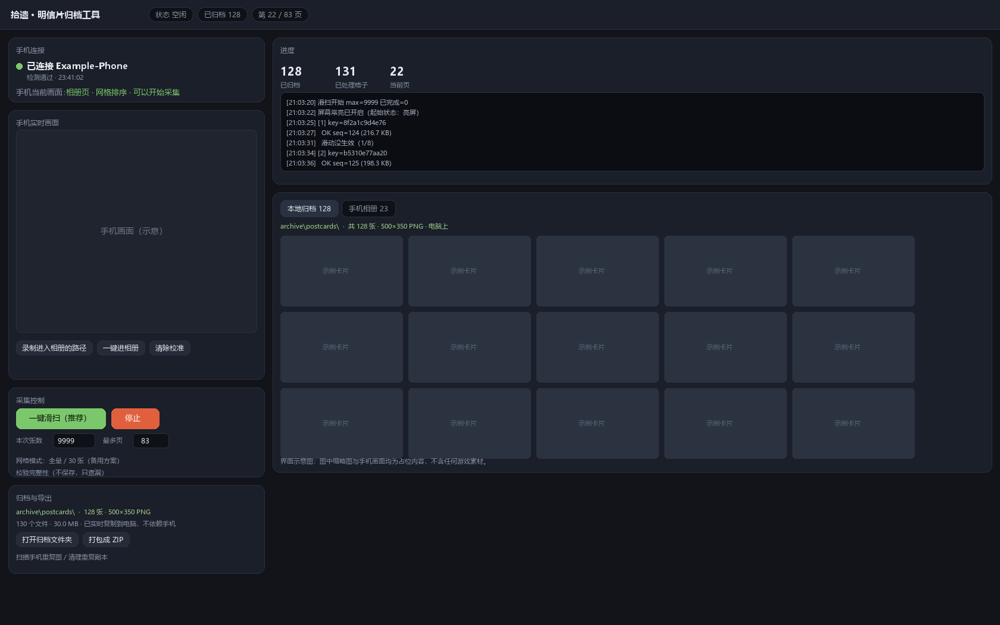

# 拾遗 keepsake · 《旅行青蛙·中国之旅》明信片归档工具

**简体中文** · [English](README.en.md)

**这个工具是专为《旅行青蛙·中国之旅》的明信片相册写的。**
游戏里每张明信片都能手动「保存到相册」，但数量上百时逐张点击不现实。
本工具在你自己的电脑上通过 ADB 驱动手机，自动完成「打开 → 保存 → 翻下一张」，
并把新产生的原图**实时复制到电脑**，同时生成一份可读的归档清单。



> 上图为工具的操作界面。图中缩略图与手机画面均为占位内容，不含任何游戏素材。

**适用对象**：《旅行青蛙·中国之旅》（Android 版）的明信片相册。
采集逻辑本身不绑定具体内容——具备「详情页 + 保存按钮 + 左右滑动切换」三要素的相册类 App，
在重新标定坐标后同样可以使用；但**默认参数是按这款游戏标定的**。

> **本仓库不包含任何游戏素材，也不修改任何游戏客户端。**
> 工具只做三件事：截屏识别界面、模拟手指点击、监听并复制新产生的图片文件。
> 没有破解、没有读取应用私有数据、没有内置任何美术资源。

---

## 目录

- [它解决什么问题](#它解决什么问题)
- [它做什么，不做什么](#它做什么不做什么)
- [工作原理](#工作原理)
- [环境要求](#环境要求)
- [快速开始](#快速开始)
- [首次使用：校准](#首次使用校准)
- [采集流程](#采集流程)
- [归档格式](#归档格式)
- [本地浏览与导出](#本地浏览与导出)
- [适配其他机型](#适配其他机型)
- [常见问题](#常见问题)
- [隐私说明](#隐私说明)
- [法律与边界](#法律与边界)
- [目录结构](#目录结构)
- [开发说明](#开发说明)
- [AI 生成声明](#ai-生成声明)

---

## 它解决什么问题

《旅行青蛙·中国之旅》的相册里，保存一张明信片需要：打开一张、点保存、关掉、再打开下一张。
几百张下来，手动点击既枯燥又容易漏，而且**你无法确认哪些漏了**。

本工具把这套动作交给脚本，并且**只以"磁盘上真的多了一个新文件"作为成功判据**——
不依赖"我点过了，应该成功了吧"这种假设。每张图都会记录文件哈希，
跑完之后还能再走一遍相册，逐张核对有没有漏采。

导出的图片是游戏**自己**写出来的原图（500×350 PNG，无边框无水印），
不是屏幕截图，因此没有二次压缩损失。

---

## 它做什么，不做什么

| 做 | 不做 |
|---|---|
| 截屏，用模板匹配定位按钮 | ❌ 不破解加密、不逆向密钥 |
| 注入点击（长按 160–320 ms） | ❌ 不读取 App 私有目录 / 内存 / 数据库 |
| 监听相册目录，发现新文件 | ❌ 不修改 App、不注入代码、不 hook |
| 把新文件复制到电脑并写清单 | ❌ 不上传任何数据，全程离线 |
| 按文件哈希去重、按画面哈希判重 | ❌ 不内置、不分发任何游戏素材 |
| 本地网页浏览、打包 ZIP | ❌ 不提供任何形式的账号数据访问 |

**唯一的外部依赖**是这个 App 自己提供的「保存到相册」功能——工具只是替你点它。

---

## 工作原理

```
┌─────────┐   ① 截屏 (adb exec-out screencap)   ┌──────────────┐
│  手机    │ ◀────────────────────────────────── │              │
│  App UI  │                                      │  采集引擎     │
│         │ ──────────────────────────────────▶ │  (Python)    │
└─────────┘   ② 点击 (adb shell input swipe)     │              │
     │                                            └──────┬───────┘
     │ ③ App 自己把图写到 /sdcard/Pictures/<时间戳>.png     │
     ▼                                                    │
┌─────────────┐   ④ 轮询目录，发现新文件  ────────────────┘
│ 手机相册目录 │   ⑤ adb pull 复制回电脑 + 写 manifest.json
└─────────────┘
```

关键设计（都是踩坑后确定的）：

1. **点击必须"长按"**：`adb shell input tap` 的按压时间过短，部分引擎（如 Egret/Canvas 系）
   会把它当成无效手势吞掉。统一改用 `input swipe x y x y 160`，等价于一次 160 ms 的真实按压。
2. **保存后 App 会锁输入 2–3 秒**：此时点击「关闭」按钮无效。必须等待后再操作。
3. **成功信号只看文件**：每次保存前记录目录快照，保存后轮询新文件出现（最长 10 秒）。
   出现文件才算成功，否则重试或安全停止。
4. **翻页用滑动，不用网格坐标**：详情页支持左右滑动切换相邻卡片，
   于是采集变成「保存 → 左滑」的循环，彻底避开了网格排版、分页、排序方式带来的错位。
5. **区分"滑不动"与"到头了"**：对每一帧计算「明信片区域 + 页码区域」的联合哈希。
   哈希不变 = 滑动没生效（重试）；只有连续多次无效且已走过接近全量，才判定到达末尾。

---

## 环境要求

| 项 | 要求 |
|---|---|
| 操作系统 | Windows 10 / 11（主要验证环境）<br>macOS / Linux 理论可用，未实测 |
| Python | 3.10+（用到 `os.replace`、f-string、`dict` 顺序等） |
| 依赖 | `numpy`、`Pillow`（见 `requirements.txt`） |
| ADB | Google platform-tools 的 `adb` |
| 手机 | Android 设备，已安装目标 App 并登录；已开启「USB 调试」 |
| 屏幕 | 当前版本按 **1316 × 2832** 校准；其他分辨率需重新标定（见[校准](#首次使用校准)） |

> 已验证环境：HarmonyOS 4.3.0（Android 12 / API 31）、arm64。

---

## 快速开始

```bash
git clone https://github.com/TinyYang/keepsake.git
cd keepsake
pip install -r requirements.txt
```

**准备 adb**（三选一）：

```text
① 把 platform-tools 解压到  tools/platform-tools/   （推荐，仓库已忽略该目录）
② 设置环境变量  ADB_PATH=D:\platform-tools\adb.exe
③ 把 adb 放进系统 PATH
```

**连接手机**：

```bash
adb devices -l
```

看到 `xxxxxxxx  device` 才算连接成功。若显示 `unauthorized`，请在手机上点「允许 USB 调试」。
若显示为空，检查数据线（很多线只供电）、USB 模式是否选「传输文件」、是否装了手机助手类软件占用端口。

**启动工具**（Windows 双击）：

```text
启动工具.cmd
```

会启动一个只监听 `127.0.0.1` 的本地服务并自动打开浏览器（默认 <http://127.0.0.1:8787/>，
端口被占用时自动顺延）。

macOS / Linux：

```bash
python scripts/server.py
```

---

## 首次使用：校准

当前版本内置了若干**与屏幕分辨率强相关的常量**，换设备必须重新标定。首次使用请按顺序做：

### 1. 确认分辨率

```bash
adb shell wm size
```

若结果不是 `1316x2832`，请先阅读 [docs/CALIBRATION.md](docs/CALIBRATION.md)。

### 2. 录制「进入相册」的路径

工具需要知道怎么从 App 主界面走到相册页。这一步由你手动示教一次：

1. 把手机停在 App **主界面**
2. 页面上点「**录制进入相册的路径**」
3. **在网页左侧的手机画面里**，按你平时的操作顺序点几下（每点一下，手机会真的跟着点）
4. 到达相册页后，点「**结束录制并保存**」

录制结果保存在 `probe/nav.json`，之后每次采集会自动复用。
若没有录制，工具会退回使用内置的默认路径（按比例换算，可能不准）。

### 3. 打开一张明信片

采集引擎以「详情页」为起点。工具的「一键滑扫」会自动完成这一步；
如果你手动操作，请先打开相册里任意一张明信片，停在详情页。

---

## 采集流程

推荐按下面四步走，每步都可以中断、可以续跑：

### ① 一键滑扫

页面点「**一键滑扫（推荐）**」。它会：

```text
开启充电常亮 → 检查是否锁屏 → 冷启动 App → 走导航进相册
→ 打开第一张 → [保存 → 左滑] 循环 → 到达末尾自动结束
```

- 每张约 9–10 秒（含保存后的等待与稳定期）
- 已归档过的画面会被跳过，不重复占用手机空间
- 进度写入 `probe/sweep_state.json`，中断后重跑会先快进到最后位置

### ② 扫描手机重复图

页面点「**扫描手机重复图**」。它会统计手机相册目录里：

- 有多少个「时间戳命名」的 PNG
- 其中多少张是唯一图、多少个是重复副本
- 哪些其实是别的 App 的图片（按尺寸 500×350 过滤掉）

### ③ 评审并清理

点「**清理重复副本**」会打开评审面板：每组并排展示缩略图，
**左边是保留的那份，右边是可删除的副本**，逐张可取消勾选；确认后才会删除。

安全约束：

- 只删除内容完全相同（md5 相同）的副本，每组至少保留 1 份
- 只处理尺寸 500×350 的图片，其他文件一律不动
- 删除接口带白名单校验，不在清单里的文件会被拒绝

### ④ 校验完整性

页面点「**校验完整性**」。它会重新走一遍相册，**只读不保存**，
逐张比对「这张画面是否已归档」，最后输出未归档数量。为 0 即代表没有漏采。

> 校验依赖滑扫阶段记录的画面哈希，请先跑完滑扫再做校验。

---

## 归档格式

```
archive/
├── manifest.json        每张图的元数据（明文 JSON，不加密）
├── postcards/           原图
│   ├── 0001_1792320907585.png
│   └── ...
└── README.txt           写给未来的人：这些文件是什么、怎么来的
```

`manifest.json` 字段：

| 字段 | 含义 |
|---|---|
| `seq` | 归档序号，与文件名前缀一致 |
| `file` | 相对路径 |
| `original_name` | App 导出的原始文件名（通常是毫秒时间戳） |
| `source` | 来源方式 |
| `device` / `package` | 采集设备与目标 App 标识 |
| `order` | 在相册中的遍历顺序（滑扫模式） |
| `captured_at` | 采集时间 |
| `bytes` / `sha256` | 文件大小与哈希（用于去重与校验） |
| `width` / `height` | 图片尺寸 |
| `location` / `note` / `favorite` / `hidden` | 预留：地点、备注、收藏、隐藏 |

原图一律**只读**：整理、去重、改名只生成副本，不覆盖原始文件。

---

## 本地浏览与导出

页面底部有「本地归档 / 手机相册」两个标签页：

- 缩略图墙，点击全屏，`←` `→` 翻页，滚轮缩放
- 「打包成 ZIP」把 `archive/` 打成可下载的压缩包
- 「打开归档文件夹」直接定位到本地目录

浏览是纯静态的，不依赖网络。

---

## 适配其他机型

三个因素会导致需要重新标定：**分辨率**、**App 版本 UI**、**系统对注入事件的策略**。

标定方法见 [docs/CALIBRATION.md](docs/CALIBRATION.md)，核心是改这几处常量：

| 常量 | 位置 | 含义 |
|---|---|---|
| `SLOTS` | `scripts/frogcap.py` | 网格页 6 个卡片的中心坐标 |
| `CAMERA_BOX` / `CAMERA_PT` | `scripts/frogcap.py`、`scripts/swipecap.py` | 详情页相机图标的匹配区域与点击点 |
| `CLOSE_PT` | 同上 | 详情页右上角关闭按钮 |
| `SWIPE_FROM` / `SWIPE_TO` | `scripts/swipecap.py` | 左滑的起点与终点 |
| `POSTCARD_CROP` | 同上 | 画面区域，用于计算哈希 |
| `PAGE_CROP` | 同上 | 页码区域，用于判断"卡住/换图" |

模板图（`templates/camera_icon.png`）由工具在运行时从你自己的截图裁剪生成，
**不随仓库分发**。

---

## 常见问题

| 现象 | 原因 | 处理 |
|---|---|---|
| 页面显示「未检测到手机」 | adb 起不来 / 线只供电 / 未授权 | 先 `adb devices` 手工验证；点页面「诊断」看原始返回 |
| 端口被占用，页面打不开 | 旧进程残留 | 工具会自动顺延端口，以命令行窗口打印的地址为准 |
| 反复出现「滑动没生效」 | 游戏忙 / 动画未结束 | 引擎会自动重试 8 次；仍失败会安全停止并保留进度 |
| 采集中途停了 | 锁屏 / 接电话 / 断线 | 解锁后重新点「一键滑扫」，会从断点继续 |
| 保存后关不掉弹窗 | App 在保存后锁输入 2–3 秒 | 已内置 2.6–4 秒等待；不要手动干预 |
| 重复图片越积越多 | 早期版本会重复保存 | 跑一遍「扫描 → 评审 → 清理」 |
| 导出图片只有 500×350 | 这是 App 自身导出的原始分辨率 | 屏幕截图只能得到放大版，不会更清晰 |

---

## 隐私说明

- **全部数据留在本机**：图片、清单、日志都在 `archive/` 与 `probe/` 下。
- **不联网**：除本机 `127.0.0.1` 外，工具不发起任何请求。
- **仓库不含个人数据**：`.gitignore` 已排除 `archive/`、`probe/`、`templates/`、`export/`。
  其中 `probe/` 会保存运行期截图（可能包含你的桌面、通知、壁纸），**切勿提交**。
- 若你需要提交 issue，请先删除截图中的个人信息（设备序列号、通知内容、壁纸照片等）。

---

## 法律与边界

- 本工具**仅供个人在自有设备上备份自己可见的内容**。
- 仓库**不包含**任何游戏美术、音乐、文本或客户端文件；模板图在运行时由用户自己的截图生成。
- 请勿将导出的素材公开传播、二次分发或用于商业用途。
  相关作品的著作权归原权利人所有。
- 使用本工具可能违反目标 App 的用户协议，请自行评估并承担相应风险。
- 本项目与任何游戏厂商、发行商无关，未获其授权或背书。

---

## 目录结构

```
keepsake/
├── README.md
├── README.en.md              英文文档
├── AGENTS.md                 面向 AI/协作者的仓库约定
├── LICENSE
├── requirements.txt
├── .gitignore
├── 启动工具.cmd              Windows 一键启动
├── ui/
│   └── index.html            本地网页界面（无构建、无框架）
├── scripts/
│   ├── server.py             本地 HTTP 服务 + 采集进程管理
│   ├── swipecap.py           主采集引擎（滑扫模式）
│   ├── frogcap.py            备用采集引擎（网格模式）
│   ├── phone_clean.py        手机端重复图扫描 / 清理
│   ├── fix_archive.py        归档序号修复与 manifest 重建
│   ├── bootstrap_pylibs.py   受限环境下的依赖引导（可选）
│   ├── analyze_grid.py       开发辅助：网格几何测量
│   ├── exp_precision.py      开发辅助：导出精度对照实验
│   └── match_one.py          开发辅助：单帧状态判定
└── docs/
    ├── ARCHITECTURE.md       设计细节与踩坑记录
    ├── CALIBRATION.md        机型标定指南
    ├── TROUBLESHOOTING.md    故障排查
    ├── COMPLIANCE.md         合规边界
    ├── 勘察与选型.md          前期勘察与方案选择记录
    └── ui-preview.png        界面示意图（占位内容）
```

---

## 开发说明

**主要脚本职责**

| 文件 | 职责 |
|---|---|
| `server.py` | 提供网页接口；拉起/停止采集子进程；代理实时画面 |
| `swipecap.py` | 滑扫采集：保存 → 左滑；含锁屏、黑屏、卡住检测 |
| `frogcap.py` | 网格采集：按 6 格坐标逐页点选；作为备用方案 |
| `phone_clean.py` | 手机端口令：扫描重复、按清单删除 |
| `fix_archive.py` | 重排序号、按现有文件重建 manifest |

**没有构建步骤**：前端是单个 HTML，后端只用标准库 + numpy + Pillow。

**自测方式**（不需要手机的部分）：

```bash
python -m py_compile scripts/*.py
```

**已知限制**

- 坐标常量与分辨率绑定，换机型需标定
- 依赖 App 详情页支持左右滑动；若某版本移除该交互，需改用网格模式
- 对系统省电策略敏感：采集期间必须保持亮屏、不锁屏
- 未在 ARM Mac、Linux 桌面、非 HarmonyOS 设备上实测

---

## AI 生成声明

**本项目由 AI 辅助生成，并经人工实测与修订。**

- 绝大部分代码与文档由 AI 编程助手（DeepSeek Harness）生成
- 关键决策（技术选型、坐标标定、失败处理策略）来自与设备真实交互的实测结果
- 所有交互参数（按压时长、等待时间、匹配阈值）均由实测得出，见 `docs/ARCHITECTURE.md`
- 维护者对代码进行了审查，但**不保证**其在所有设备上的正确性

请把它当作一个"经过实测的参考实现"，而不是经过完整测试矩阵验证的工业软件。

---

## 致谢

- 触发器与灵感：一次关于"游戏停服前如何保存自己的记录"的讨论
- 方法参考：ADB、MediaProjection 与模板匹配的常规实践
- 所有测试都在作者自己的设备上完成

---

## 许可证

[MIT](LICENSE)。仅覆盖本仓库的代码与文档，不涉及任何游戏素材。
